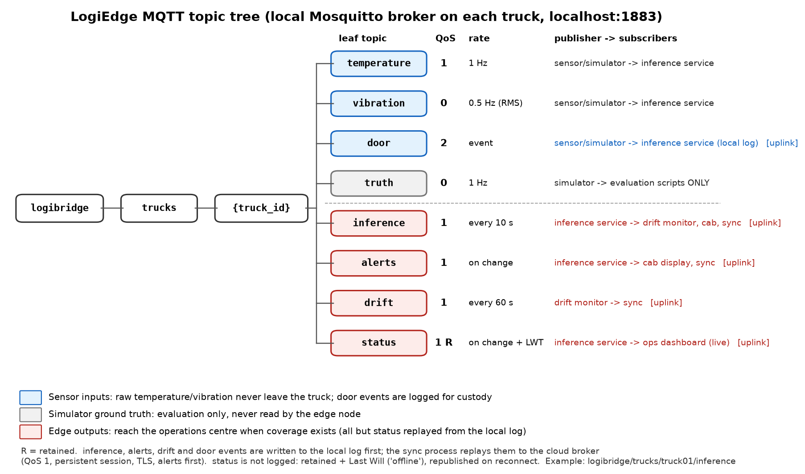

# Tasks C1–C3 — MQTT architecture, preprocessing and data fusion

## 1. Topic tree



*Figure generated by `make_mqtt_topic_tree.py`.*

Every truck runs its own Mosquitto broker (`localhost:1883`). All topics share one namespace:

```
logibridge/
└── trucks/
    └── {truck_id}/              e.g. truck01
        ├── temperature          sensor input        QoS 1
        ├── vibration            sensor input        QoS 0
        ├── door                 sensor input        QoS 2
        ├── truth                simulator only      QoS 0   (evaluation, never read by the node)
        ├── inference            edge output         QoS 1   (topic required by Task D2)
        ├── alerts               edge output         QoS 1
        ├── drift                edge output         QoS 1
        └── status               edge output         QoS 1, retained, Last Will = offline
```

Keeping `{truck_id}` in the path means the same tree works on a truck's local broker and on the
operations-centre broker. A fleet dashboard subscribes to `logibridge/trucks/+/alerts`, and access
rules on the cloud broker can be written per truck (`logibridge/trucks/truck01/#`).

## 2. QoS per topic

The sensor QoS values are the ones coded in `simulator.py`. The output QoS values are the
design for the inference service (Task D2).

| Topic | QoS | Why |
|---|---|---|
| `temperature` | 1 | The primary cargo-safety signal and a model input. A lost reading leaves a gap in the window: the featuriser needs at least 10 of the 30 readings, or it skips the window entirely. At-least-once delivery can duplicate a reading after a reconnect, so the consumer drops any reading whose timestamp is not newer than the last one. QoS 2's four-packet handshake adds nothing beyond that. |
| `vibration` | 0 | A 2-second RMS summary computed next to the sensor, so the raw 500 Hz, 3-axis signal never crosses the broker. One lost summary removes 1 of 15 samples from a window (at least 5 are required), and the next arrives 2 s later. Stale vibration values queued during a reconnect would be worthless, so QoS 0's "no backlog" behaviour is an advantage. |
| `door` | 2 | Discrete state changes recorded in the chain-of-custody log. A lost `CLOSE` or a duplicated `OPEN` would corrupt the door-open durations that a hospital may ask for. That was incident 2 (shipment rejected for incomplete documentation). The simulator alternates 20–60 s closed and 3–10 s open, about 100–300 events per hour, which is far more than a real delivery route. Even at 300 events/hour, QoS 2 costs four packets per event on each of the two localhost hops (sensor → broker and broker → logger): 300 × 4 × 2 / 3600 ≈ 0.67 packets/s, which is negligible. QoS 2 guarantees exactly-once delivery **on this MQTT hop only** (sensor → local broker → logger). End-to-end, each event is appended to the local log with a sequence number. The upload to the operations centre uses QoS 1 with de-duplication by that sequence number (see below). |
| `truth` | 0 | Simulator ground truth (noise-free offset and fault flags), used only to label datasets and score evaluations. The edge node never subscribes to it. |
| `inference` | 1 | One result every 10 s: class, three probabilities, model hash, window end time. The drift monitor computes PSI over the last 100 results, so silent loss would bias it. A duplicate is harmless, because consumers key on the window end time. |
| `alerts` | 1 | A Warning or Critical state change. The alert is **first appended to the local alert log** and only then published. Each entry carries a sequence number, so QoS 1 duplicates are removed at the receiver. At-least-once plus de-duplication gives exactly-once in effect, without QoS 2's longer handshake, which is more fragile on a weak rural signal. |
| `drift` | 1 | PSI value every 60 s and the drift-alert flag. Low rate, and every value is needed for the MLOps record. |
| `status` | 1, retained, LWT | Model hash, start time and online/offline state. Retained, so a dashboard that connects later sees the current state at once. The broker publishes the Last Will (`offline`) if the service dies without disconnecting. |

### Offline operation and synchronisation

Raw sensor topics never leave the truck. That keeps bandwidth low (A1: about 519 MB/day raw
against about 1 MB/day of outputs) and supports the privacy argument (A1).

**What is stored durably.** The inference service appends to a **local log** on the truck's
storage (one SQLite file). Each entry is written *before* the matching MQTT publish and carries
a per-truck sequence number and a `synced` flag:

| Record | Logged locally | Replayed after a dead zone | Why |
|---|---|---|---|
| Every inference result (one per 10 s) | Yes | Yes, after alerts | It is the continuous cargo-condition record. About 8,640 entries/day at about 150 B is 1.3 MB/day on the truck and the same order as A1's uplink estimate. A gap-free record is what the rejected shipment (incident 2) lacked. |
| Alerts (Warning/Critical state changes) | Yes | Yes, **first** | The operations centre needs these before anything else. |
| Door events | Yes | Yes, in order | Chain of custody (door-open durations). |
| Drift (PSI every 60 s, drift alerts) | Yes | Yes | MLOps record, 1,440 small entries/day. |
| Status | No | No: republished, retained, on reconnect | Only the *current* state matters. The retained message and the Last Will handle it. |

**How it is synced.** A sync process reads unsynced entries from the log, not the live topics,
and publishes them to the cloud broker with QoS 1 over TLS with per-truck credentials, on a
persistent session (`clean_start = False`). Alerts go first, then the remaining entries oldest
first. An entry is marked *synced* only when the cloud broker acknowledges it (PUBACK). If the
connection drops mid-upload, unacknowledged entries are sent again. The operations centre
ignores sequence numbers it has already stored, so the result is exactly-once in effect.
During a 35–90 minute dead zone the node keeps classifying and alerting the cab, and the
backlog grows: 90 minutes is about 540 inference entries, roughly 80 KB. A plain Mosquitto
bridge was rejected because its queue is held by the broker, has a size limit and has no
priority order, which is not good enough for a chain-of-custody record.

## 3. Preprocessing design rationale (Task C2)

The order is: filter → window → features → normalise. All of it is in `preprocessing.py`, and
the same file runs offline (dataset build) and in the container (live), so training and
inference cannot diverge.

| Step | Choice | Reason |
|---|---|---|
| Filtering | Causal 5-sample moving average on temperature and vibration | Reduces independent sensor noise by √5: temperature σ 0.3 → about 0.13 °C. Causal, so it can run live. The cost is a delay of 2 samples (2 s for temperature, 4 s for vibration), which is small against the 90 s SLA. |
| Window | 30 s, step 10 s | 30 temperature and 15 vibration samples per decision, with a decision every 10 s. The drift fault (+0.08 °C/s = 4.8 °C/min) reaches Warning (1 °C) after 12.5 s and Critical (> 3 °C) after 37.5 s, so a 30 s window still captures a clear slope before the breach. |
| Temperature features | Mean, standard deviation, least-squares slope in °C/min | Mean tracks the offset from setpoint. The slope separates a refrigeration failure (4.8 °C/min) from noise: the clean-data σ of the slope is 0.39 °C/min, so a failure sits about 12σ away. A least-squares fit uses all 30 points, while an end-point difference would amplify noise. |
| Vibration features | RMS, peak, kurtosis | RMS measures compressor energy (0.45 g normal, 1.2 g bearing wear). Peak catches short spikes. Kurtosis describes the shape of the distribution. Kurtosis estimated from 15 samples is noisy (clean-data σ 0.51), which is a known weakness. |
| Normalisation | z-score with `training_stats.npy`: mean and std of each feature from clean Normal data, computed once offline | Loaded at start-up and never recomputed from live data. Statistics recomputed during a fault would treat the fault as the new normal. The experiment below shows how sensitive the model is to wrong statistics. |

### Mandatory experiment: correct vs 3σ-shifted statistics

Script: `normalisation_experiment.py`. Results: `results/normalisation_experiment.json`. The
models are the committed `.tflite` files and were not retrained. The validation set is 86
windows (24 Normal, 18 Warning, 44 Critical). Each feature's mean is shifted by 3 × its std,
and the std is left unchanged.

| Statistics used | M2 accuracy | M2 Critical recall | M1 accuracy | M1 Critical recall |
|---|---|---|---|---|
| Correct | 100.0 % | 100.0 % | 100.0 % | 100.0 % |
| All means +3σ | **91.9 %** | **84.1 %** | 91.9 % | 84.1 % |
| All means −3σ | 96.5 % | 93.2 % | 95.3 % | 90.9 % |
| Worst single feature: `temp_std` +3σ | 94.2 % | 88.6 % | 94.2 % | 88.6 % |

The 100 % baseline is a result on this split of simulated data, not evidence of how the model
generalises to real trucks. What the experiment does show:

- **The errors fall in the dangerous direction.** Normal recall stays at 100 % in every
  condition, so there are no false alarms. With +3σ, 7 of 44 Critical windows are downgraded to
  Warning. That is a late escalation, the costly error in cold-chain monitoring.
- **3σ is a small physical error.** Because σ comes from clean data only, the shift is just
  0.14 °C on temperature mean and 0.034 g on vibration RMS. A miscalibrated sensor or statistics
  from another truck could cause it. That is why the statistics are frozen and versioned with the
  model: they ship in the same container image, so a model is never paired with the wrong statistics.
- **The model relies on features from both sensors.** Shifting only temperature mean or slope
  changes nothing. Shifting `temp_std`, `vib_rms`, `vib_peak` or `vib_kurtosis` does.

## 4. Data fusion level (Task C3)

LogiEdge uses **feature-level fusion**. Each sensor is filtered and summarised on its own
(3 temperature features and 3 vibration features), and the two vectors are joined into one
6-value input for a single classifier.

**Against data-level fusion** (joining raw samples):
- The streams differ in rate and meaning: 1 Hz temperature, 500 Hz 3-axis vibration on a real
  truck, and irregular door events. Joining them raw means resampling onto a common clock.
  That either throws vibration detail away or repeats each temperature reading 500 times.
- The model would have to learn feature extraction from raw data, which needs a convolutional or
  recurrent network and far more than about 400 labelled windows. That would break the
  few-kilobyte model and microsecond inference (F2) that leave the latency budget untouched.
- Raw data would have to reach the model process. Features cut 518 MB/day of vibration to six
  numbers every 10 s, close to the sensor.

**Against decision-level fusion** (separate classifiers per sensor, then a vote or rule):
- The classes are defined by *combinations*: Critical is a temperature breach **or** a
  refrigeration-failure signature, and the `combined` fault shows both. A single model on the
  joint vector can use the evidence together. For example, an early temperature slope
  combined with high vibration is stronger evidence than either alone. Two separate
  classifiers each see only half the picture.
- Each per-sensor model would also need its own labels. "Vibration Normal but temperature
  Critical" cannot be labelled from the vibration stream alone.

**What fusion costs, from our own results.** The first (v1) models were trained with Critical
examples only from the `combined` fault. On fresh recordings they caught **0 of 14**
temperature-only Critical windows and **0 of 18** vibration-only ones
(`optimisation/results/transitions_diag_frozen_analysis.json`, M2). The fused model had learned
the *joint* signature and missed each failure mechanism on its own. The v2 dataset fixed this
by recording each mechanism separately (temperature-only, vibration-only and combined faults),
which raised whole-stream Critical recall to 86 % (F2). The lesson: with feature-level fusion,
the training data has to cover every combination the field can produce.

**Result: a hybrid in deployment.** The deployment recommendation (F3) adds independent
temperature and vibration threshold rules beside the fused model. That is a decision-level
safety layer: the alert fires if the model **or** either rule says Critical. The fused model
gives the early, combined judgement; the rules make sure a single-sensor failure is never
missed because of how the model learned to combine the two sensors.
